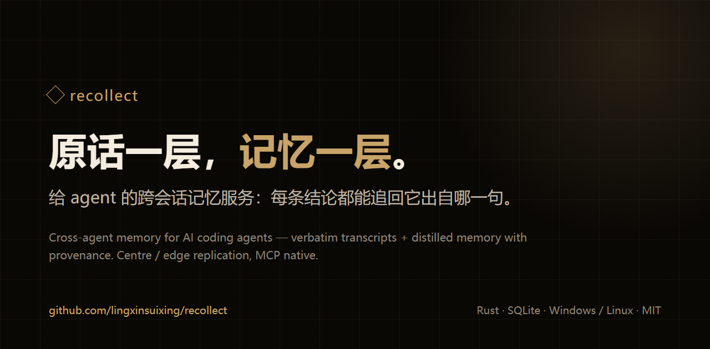

# recollect

English | [简体中文](README.md)

[](https://github.com/lingxinsuixing/recollect/releases)
[](https://github.com/lingxinsuixing/recollect/blob/main/LICENSE)
[](https://github.com/lingxinsuixing/recollect/releases)

<p align="center"></p>

A persistent memory service for AI coding agents, exposed over MCP: **raw turns in one layer, distilled memory in another**. Switch sessions, switch machines, or go offline — your agent can still pick up where it left off.

> Status: this is the version I personally tested (v0.1.0). Issues and PRs are welcome. No fixed release cadence and no response-time promise.

- Repository: [lingxinsuixing/recollect](https://github.com/lingxinsuixing/recollect)
- Author / maintainer / current contributor: `lingxinsuixing`
- Website: <https://lingxinsuixing.github.io/recollect/> (source: `site/`, 9 static HTML pages, no build step)

## What it looks like

A real recall from this repo's own development sessions, not a mock-up:

```text
you    How did we avoid two sessions writing separate versions?

       recollect_recall(query="two sessions each write their own", view="brief")

       ▍decision · 2026-11-07 09:39 · reviewed · source turn:97cc205b
         This agent decided to read the existing audit notes first and
         align, instead of two sessions each writing their own version.

       recollect_turn(turn_uid="97cc205b…", before=2, after=2)

       agent  09:39  Three deliverables received: summary → per-gap dig →
                     pre-launch fix plan. Noticed the memory store already
                     holds two audit notes from this round, so I'll read
                     them first and align.
```

The memory card is one conclusion; follow `turn:` to the original words. A summary is an index, not a source of truth.

## What it solves

- **Session resets wipe the context.** Decisions, blockers and promises from yesterday are gone.
- **Every agent starts from zero.** The same person's preferences have to be re-explained to each agent.
- **Memory is a black box.** You get a conclusion, but not the original words or who actually said them.

## When it is useful

- Continue yesterday's work: let the agent recall the last decision, progress and open traps.
- Several agents share one "me": IDE, terminal and mobile agents read the same memory.
- Trace back to the source: expand a memory card all the way to the turn it came from.
- Multi-machine LAN: the centre runs at home; a laptop can read/write while away and merge later.
- Just remember a sentence: write it down; extraction and summaries happen in the background.

## Design choices

1. **Raw turns and memory are separate.** The transcript layer keeps verbatim text; the memory layer keeps cards, facts and events. Both are traceable. A summary is an index, not a source of truth.
2. **Centre plus edge.** The centre is authoritative; an edge holds a read-only replica, can self-distill offline, and merges back later.
3. **One read gate.** Agents of the same owner can read each other by default; environment declarations stay agent-private; the transcript surface is open to paired devices on the LAN. That is an explicit trade-off, not a missing check.
4. **The agent does not decide for you.** Recall returns evidence, time and provenance. Voting, retirement and deletion stay with the human.

## What it feels like

- **Single binary, zero install**: SQLite plus built-in HTTP/TLS, no external database or queue.
- **Chinese-friendly**: jieba tokenization; search Chinese raw text directly.
- **MCP native**: `recollect_*` memory/transcript tools and `core_*` always-on tools.
- **Auditable**: every memory row has provenance; report `reuse`, `report` mistakes.
- **Multi-machine without pain**: `hub serve` at the centre, `node pair` at the edge; offline staging merges when the centre is back.

## Quick start

1. Download from [Releases](https://github.com/lingxinsuixing/recollect/releases):
   - Windows x64: `setup.exe` (per-user) or portable `zip`
   - Linux x64: `deb` / `rpm` or portable `tar.gz` (musl static)
2. Verify `SHA256SUMS`; use `manifest.json` to pick an asset.
3. Start the centre with `recollect-hub serve`; choose a data directory with `--data-dir`.
4. **The database starts empty**; import history with `recollect-hub import`.

## Website

The site has a Chinese edition at the root and an English edition under `en/`; each page has a language switch in the top-right corner. The English pages are generated by `site/tools/translate.py` from `site/i18n/en-<page>.json`; after editing Chinese, run `python site/tools/translate.py --all`, which lists any untranslated strings and refuses to write.

- Local preview: open `site/index.html`, or run `python -m http.server 8080 --directory site` and visit `http://localhost:8080/`.
- The site explains the design only; it does not connect to a centre and carries no data.
- The 大肥鱼 image on the solo page is community fan art, not official; source: [deepseek-chan-meme-pack](https://github.com/the-beating-light-of-the-nail/deepseek-chan-meme-pack). Rights remain with the original creators; these two images are outside the MIT license, see [the asset notice](site/assets/img/NOTICE.md).
- To publish it with GitHub Pages, set **Settings → Pages → Source** to **GitHub Actions**, and use a workflow that uploads the `site` directory:

```yaml
name: pages
on:
  push:
    branches: [main]
permissions:
  contents: read
  pages: write
  id-token: write
jobs:
  deploy:
    environment:
      name: github-pages
      url: ${{ steps.deployment.outputs.page_url }}
    runs-on: ubuntu-latest
    steps:
      - uses: actions/checkout@v6
      - uses: actions/configure-pages@v5
      - uses: actions/upload-pages-artifact@v4
        with:
          path: site
      - id: deployment
        uses: actions/deploy-pages@v4
```

The site URL is <https://lingxinsuixing.github.io/recollect/>; use the `page_url` emitted by the workflow as the source of truth. A custom domain is optional.

The site is Chinese-only for now. The recommended English scope is this README plus one English overview page, not a page-by-page translation of the whole site.

## For agents (short version)

MCP startup needs three things: data directory, device name, agent name; owner is optional.

```json
{"command":"/abs/bin/recollect-mcp","args":[
  "--data-dir","/abs/data","--device-id","local-xxx",
  "--agent-id","your-agent","--principal-id","p-owner"]}
```

Three common paths:

- Catch up: `recollect_recall(query="…")`; use `view="expand"` to get `turn:<uid>`.
- Find raw words: `recollect_search(q="…")` or `recollect_turn(turn_uid="…", before=2, after=2)`.
- Remember something: `recollect_remember(body="…")`; extraction is asynchronous.

Empty results are normal: `no_rows` means "no match this time"; `no_memory` means "this node has no replica yet".
Details (importers, auto-import, setup) are in the [agent guide](docs/2026-11-09-agent-install-and-import.md) (Chinese).

## Configuring the centre LLM

**There is no one-shot command.** The configuration is `llm.toml`; keys live in the `hub secret` encrypted box; extraction/derivation runs take `--llm-config`:

```bash
cp llm.toml.example "$DATA/llm.toml"          # edit provider / model / secret_ref
recollect-hub secret init --data-dir "$DATA" --box secrets
printf '%s' "$KEY" | recollect-hub secret put --value-stdin --data-dir "$DATA" secrets:deepseek_key
export RECOLLECT_DEVICE_ID=dev-laptop
recollect-hub distill once --pass naming --data-dir "$DATA" --llm-config "$DATA/llm.toml"
```

No key values in `llm.toml`. Model names must match the preset table verbatim; self-hosted gateways use `endpoint`.
Full steps, errors and checks: [LLM configuration](docs/2026-11-09-llm-config.md) (Chinese).

## Automatic collection

Hosts keep their sessions in their own directories; the collector reads the config, converts
only the new part into exchange v1, and imports it into the transcript layer:

```bash
recollect-hub collect --config collect.toml --data-dir "$DATA" --json
recollect-hub collect --status --data-dir "$DATA"          # read watermarks only
```

`collect.toml` declares each source (directory or database), its converter, the device id and
the agent id. Converters are argv arrays on the adapter side; the core knows no host format.
A new host = one config entry + one converter.

Default cadence: one round every 30 minutes; a session is collected only after it has been quiet
for 10 minutes (never cut a session that is still being written), and the daily budget simply
pushes the rest to the next window instead of dropping it. Template:
`tools/pipeline/collect.toml.example`; converters: `tools/converters/`.

## Docs

- [Agent onboarding](docs/2026-11-08-onboarding.md)
- [Agent self-install and importers](docs/2026-11-09-agent-install-and-import.md)
- [Centre LLM configuration](docs/2026-11-09-llm-config.md)
- [Architecture](docs/2026-10-07-recollect-rust-architecture.md)
- [Releasing](RELEASING.md)

## Boundaries

- Tested here: Windows x86_64 and Linux x86_64 release artifacts, synthetic fixtures, local loopback.
- Not yet validated: arm64 release artifacts on real hardware, long-running `detached` mode, a week of unattended operation.
- No real IPs, usernames, hostnames, credentials or local absolute paths in this file.

## License and thanks

MIT, see [LICENSE](LICENSE). Issues and PRs welcome; no CLA required.

Thanks to Qoder for keeping the work moving, and to qwen3.8-flash for free quota support.

Designed by **lingxinsuixing**; implemented by agents.
