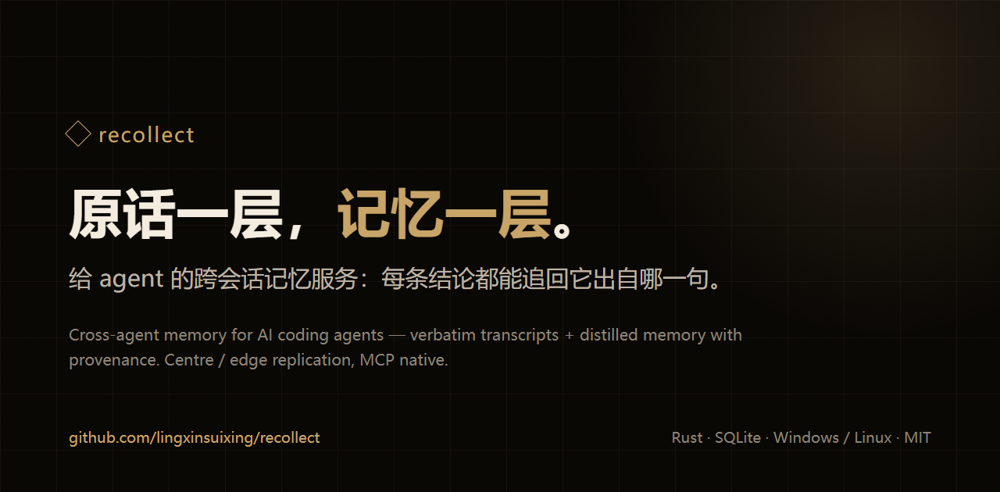

# recollect

[English](README.en.md) | 简体中文

[](https://github.com/lingxinsuixing/recollect/releases)
[](https://github.com/lingxinsuixing/recollect/blob/main/LICENSE)
[](https://github.com/lingxinsuixing/recollect/releases)

<p align="center"></p>

给 AI coding agent 用的长期记忆服务（MCP）：**原话存一层，记忆再存一层**。换会话、换机器、断网重连，agent 都还能接上之前的事。

> 当前状态：这是目前**个人测试通过的版本**（v0.1.0）。有问题欢迎开 issue 或提 PR；不保证固定更新节奏，也不承诺响应时间。

- 仓库：[lingxinsuixing/recollect](https://github.com/lingxinsuixing/recollect)
- 作者 / 维护者 / 当前贡献者：`lingxinsuixing`
- 站点：<https://lingxinsuixing.github.io/recollect/>（源码 `site/`，9 页静态 HTML，无构建步骤）

## 长什么样

下面是本仓库自己的开发会话，真实召回，不是示意图：

```text
你    上次我们怎么避免两个会话各写一套？

      recollect_recall(query="两个会话各写一套", view="brief")

      ▍决定 · 2026-11-07 09:39 · 已审核 · 出处 turn:97cc205b
        本 agent 决定先读记忆库已有沉淀档对齐，避免两个会话各写一套。

      recollect_turn(turn_uid="97cc205b…", before=2, after=2)

      agent  09:39  三件套收到：汇总文档 → 逐缺口深挖（含成熟方案参考）
                    → 上线前修复计划。注意到记忆库已有两份本次审计的
                    沉淀档，先读它们对齐，避免两个会话各写一套。
```

记忆卡只是一句结论；想确认它从哪来，沿 `turn:` 展开到原话。摘要只是索引，不是事实源。

## 它解决什么

- **换会话就断片**：上下文一清空，昨天说过的决定、卡点、答应的事全丢了。
- **多个 agent 各记各的**：同一个人的偏好和处境，每个 agent 都从零开始问一遍。
- **记忆是黑箱**：只给出结论，查不到原话，也不知道这条记得到底是谁说的。

## 什么时候会用得上

- 今天接着昨天干：让 agent 先想起上次的决定、进度和没做完的坑。
- 多个 agent 共用一个"我"：一个在 IDE、一个在终端、一个在手机端，记忆是同一份。
- 想查原话：从一张记忆卡一路展开到当时那一轮对话。
- 局域网多机：中心在家里/主机上，笔记本带出去也能读、能写，回来再合并。
- 只想记一句话：不用整理格式，写进去就行，摘要和抽取在后台做。

## 想法（为什么做成这样）

1. **原话和记忆分账。** 转录层存逐字原文，记忆层存蒸馏后的卡、事实、事件；两边都能追溯。摘要只是索引，不是事实源。
2. **中心 + 边缘。** 中心是权威；边缘拿只读副本，断网时可以自己蒸，回来合并。写坏了也能从中心重新拉。
3. **读闸只有一处。** 同一主人的 agent 默认互读；环境声明按 agent 隔离；转录面在局域网内对已配对设备开放——这是明示的取舍，不是漏写。
4. **不替你做决定。** 召回只给证据、时间和出处；表态、退休、删库这些动作留给人。

## 用起来是什么感觉

- **单文件、零安装**：SQLite + 自带 HTTP/TLS，不依赖外部数据库或队列。
- **中文友好**：jieba 分词，中文原话直接搜。
- **MCP 原生**：`recollect_*` 记忆/转录工具 + `core_*` 常驻层，agent 接上就能用。
- **能追溯**：每条记忆带出处；用过哪张卡可以报 `reuse`，记忆有错可以 `report`。
- **多机不折腾**：中心 `hub serve`，边缘 `node pair`；离线有暂存层，回来自动合并。

## 快速开始

1. 从 [Releases](https://github.com/lingxinsuixing/recollect/releases) 下载对应平台：
   - Windows x64：`setup.exe`（每用户安装）或便携 `zip`
   - Linux x64：`deb` / `rpm` 或便携 `tar.gz`（musl 静态）
2. 校验 `SHA256SUMS`，选择资产看 `manifest.json`。
3. 中心起 `recollect-hub serve`；数据目录用 `--data-dir` 指定。
4. **安装后是空库**，历史语料用 `recollect-hub import` 导入。

## 网站

站点是纯静态页面（9 页，无构建步骤、无外部依赖），入口 `site/index.html`：

- 本地打开：双击 `site/index.html`，或运行 `python -m http.server 8080 --directory site` 后访问 `http://localhost:8080/`。
- 站点只解释机制，不连接中心，也不携带任何数据；不要把中心地址、设备名或密钥写进静态页面。
- 单机页的大肥鱼形象为社区二创、非官方，素材来自 [deepseek-chan-meme-pack](https://github.com/the-beating-light-of-the-nail/deepseek-chan-meme-pack)，版权归原作者；两张图不在 MIT 范围内，详见 [素材声明](site/assets/img/NOTICE.md)。
- 发布到 GitHub Pages：在 **Settings → Pages → Source** 选 **GitHub Actions**，使用下面的工作流（`site/` 已经在仓库根目录）：

```yaml
name: pages
on:
  push:
    branches: [main]
permissions:
  contents: read
  pages: write
  id-token: write
jobs:
  deploy:
    environment:
      name: github-pages
      url: ${{ steps.deployment.outputs.page_url }}
    runs-on: ubuntu-latest
    steps:
      - uses: actions/checkout@v6
      - uses: actions/configure-pages@v5
      - uses: actions/upload-pages-artifact@v4
        with:
          path: site
      - id: deployment
        uses: actions/deploy-pages@v4
```

站点地址：<https://lingxinsuixing.github.io/recollect/>；以 Actions 输出的 `page_url` 为准。自定义域名不是必需的，以后再配也可以。

## 英文版

`README.en.md` 是英文摘要，主 README 保持中文。站点中英双版：中文在根目录，英文在 `en/`，每页右上角可切换。英文页由 `site/tools/translate.py` 按 `site/i18n/en-<page>.json` 生成——改完中文跑 `python site/tools/translate.py --all`，有漏翻会列出缺哪几句并拒绝写入。

## 给 agent 的短说明

MCP 启动参数就三件事：数据目录、设备名、agent 名；主人归属可选。

```json
{"command":"/abs/bin/recollect-mcp","args":[
  "--data-dir","/abs/data","--device-id","local-xxx",
  "--agent-id","your-agent","--principal-id","p-owner"]}
```

常用三条路：

- 想接上之前的事：`recollect_recall(query="…")`，需要原文时 `view="expand"` 拿 `turn:<uid>`。
- 想查某句原话：`recollect_search(q="…")` 或 `recollect_turn(turn_uid="…", before=2, after=2)`。
- 想记一句：`recollect_remember(body="…")`；抽取是异步的，刚写的不会立刻出现在召回里。

空结果是正常读数，不是故障：`no_rows` 就是"这次没命中"，`no_memory` 才是"这台没有可用副本"。
更细的接入、导入器写法、自动导入，见 [agent 说明书](docs/2026-11-09-agent-install-and-import.md)。

## 配置中心的 LLM

**没有一键命令。** 配置本体是 `llm.toml`，密钥放 `hub secret` 的加密箱，跑抽取/推导时用 `--llm-config` 指过去：

```bash
cp llm.toml.example "$DATA/llm.toml"          # 改 provider / model / secret_ref
recollect-hub secret init --data-dir "$DATA" --box secrets
printf '%s' "$KEY" | recollect-hub secret put --value-stdin --data-dir "$DATA" secrets:deepseek_key
export RECOLLECT_DEVICE_ID=dev-laptop
recollect-hub distill once --pass naming --data-dir "$DATA" --llm-config "$DATA/llm.toml"
```

`llm.toml` 里没有密钥值；模型名要逐字命中预设表，自建网关走 `endpoint`。
完整步骤、常见错误、验收读数见 [中心 LLM 配置](docs/2026-11-09-llm-config.md)。

## 自动采集

宿主把会话写在它自己的目录里，采集器按配置把新增部分增量转成 v1，导入转录层：

```bash
recollect-hub collect --config collect.toml --data-dir "$DATA" --json
recollect-hub collect --status --data-dir "$DATA"          # 只读水位，不动数据
```

`collect.toml` 声明每个源的目录或库、转换器、设备名与 agent 名；转换器是 argv 数组（属于适配器侧），
核心不认任何宿主格式。新增一个宿主 = 一份配置 + 一个转换器。

默认节奏：每 30 分钟一轮，会话停笔 10 分钟之后才收（不在正在写的会话上切段），
当日额度用满就顺延到下一个窗口，不丢数据。模板见 `tools/pipeline/collect.toml.example`，
转换器见 `tools/converters/`。

## 命令面

<!-- commands:start -->
hub import | collect | index | cycle | distill | derive | issue | environment | pending | anomaly | episode | fingerprint | serve | tls | pair | invite | revoke | backup | purge | restore | replicate | promote | fence | epoch | snapshot | secret | key | backup-key | ownership | principal | anchor | review | reconcile | handoff
hook brief | probe
eval extract | inject | pass | recall | seed | threshold
node --code CODE | --once | --push | --pull | (no flag = status)
mcp --data-dir DIR [--device-id ID] [--replica]
doctor [--capabilities] [--json] [--data-dir DIR] [--device-id ID] [--now-ms MS]
<!-- commands:end -->

## 文档

- [agent 接入指南](docs/2026-11-08-onboarding.md)：工具怎么用、空读数怎么读、两阶段导入。
- [agent 自安装与导入器](docs/2026-11-09-agent-install-and-import.md)：自己装、自己写导入器、自动导入。
- [中心 LLM 配置](docs/2026-11-09-llm-config.md)：`llm.toml`、密钥箱、换座与验收。
- [架构](docs/2026-10-07-recollect-rust-architecture.md)：分层、依赖边界与数据面。
- [发布流程](RELEASING.md)：单提交发布、两平台产物。

## 边界

- 只承诺本仓跑过的路径：Windows x86_64 与 Linux x86_64 的 release 产物、合成夹具、本地回环。
- 未跑臂如实登记：真机 arm64 的 release 产物、真机 `detached` 的长时间运行、无人值守一周的连续读数。
- 本文件不写真实 IP、真实用户名、真实设备名、凭据或本机绝对路径。

## 许可证与致谢

MIT，见 [LICENSE](LICENSE)。欢迎 issue / PR，不要求 CLA。

感谢 Qoder 让任务得以持续推进；感谢 qwen3.8-flash 的免费额度支持。

本项目由 **lingxinsuixing** 设计，由 agent 实现。
